

  <h1>Owl</h1>
  <h3>by shadow</h3>
  <h3>total time spent : 29 hours </h3>

--- 

### journal #1 research and picking the chip 
time spent : 2.5 hours   

  
so after doing a bunch of usb boards i wanted to make my own microcontroller dev board, something like a blue pill but actually made by me and with usb c. i didnt want to just copy an existing board so i spent a good while comparing stm32 chips  
  
ended up going with the STM32F072CBT6. reasons:
- it has native usb, so you can flash it and talk to it over usb without any extra usb to uart chip
- it can even do usb without a crystal, it has a clock recovery thing built in (i still added a crystal, more on that later)
- 128kb flash, which is plenty for most stuff i would do
- its lqfp-48, so the pins are big enough to actually solder by hand if i ever need to  

read through the datasheet and the hardware getting started guide from st to figure out what it needs, which power pins need what caps, how boot0 works and what pins the usb and swd are on
  

  
| the stm32f072 in the schematic |
| --- |
| 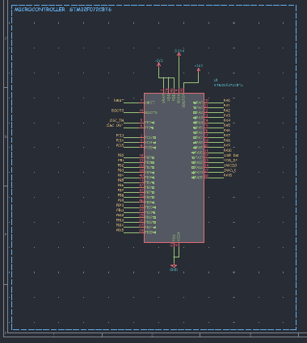 |

all those pins go out to labels, i didnt want 48 wires going everywhere lol

--- 

### journal #2 usb c and esd protection  
time spent : 1.5 hours   

  
started the schematic with the usb c port, at this point i could do this one in my sleep tbh. 5.1k resistors on CC1 and CC2 so the board gets 5v from any charger or laptop, D+ and D- from both sides of the connector tied together, and a USBLC6-2SC6 on the data lines for esd protection. SBU pins get the no connect flags
  

  
| usb c and esd |
| --- |
| 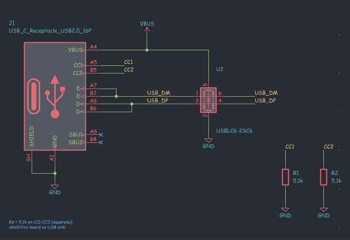 |

--- 

### journal #3 power supply  
time spent : 1.2 hours   

  
vbus goes through a 500mA polyfuse first so if i short something on the headers it doesnt fry my laptops port. then an AMS1117-3.3 brings it down to 3.3v for the chip. 10uF on the input and a 22uF tantalum on the output, the ams1117 is kinda picky about the output cap so i went with what the datasheet says. also a green power led with a 1k resistor so you know when its on  
  
added PWR_FLAGs on vbus, 5v, 3.3v and gnd straight away this time because i know erc is gonna yell otherwise
  

  
| power |
| --- |
| 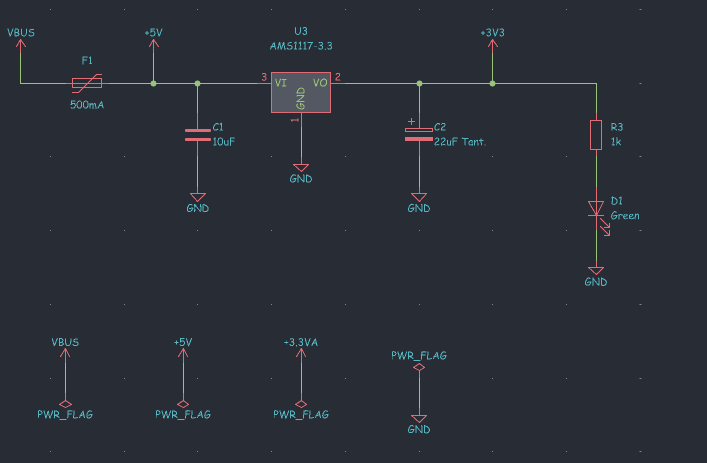 |

--- 

### journal #4 decoupling, crystal, reset and boot  
time spent : 2.5 hours   

  
this was the bulk of the schematic. the stm32 has a bunch of power pins (VDD, VDDA, VDDIO2, VBAT) and every one of them needs its own 100nF cap, plus 4.7uF bulk caps. VDDA is the analog supply so it gets a 600R ferrite bead with a 1uF and 10nF cap to keep the noise from the digital side out of the adc  
  
for the clock i added an 8MHz crystal (10pF load) with two 10pF caps. like i said the f072 can do usb without it, but with a real crystal the timing is way more accurate, and its like 2 cents so why not  
  
then the reset and boot stuff:
- a reset button on NRST with a 100nF cap
- a boot0 button with a 10k pulldown, hold it while pressing reset and the chip goes into the usb bootloader, so you can flash it over usb without any programmer
- a blue user led on PA5 so the first program anyone writes (blink) just works
  

  
| decoupling, crystal, led, reset and boot |
| --- |
| 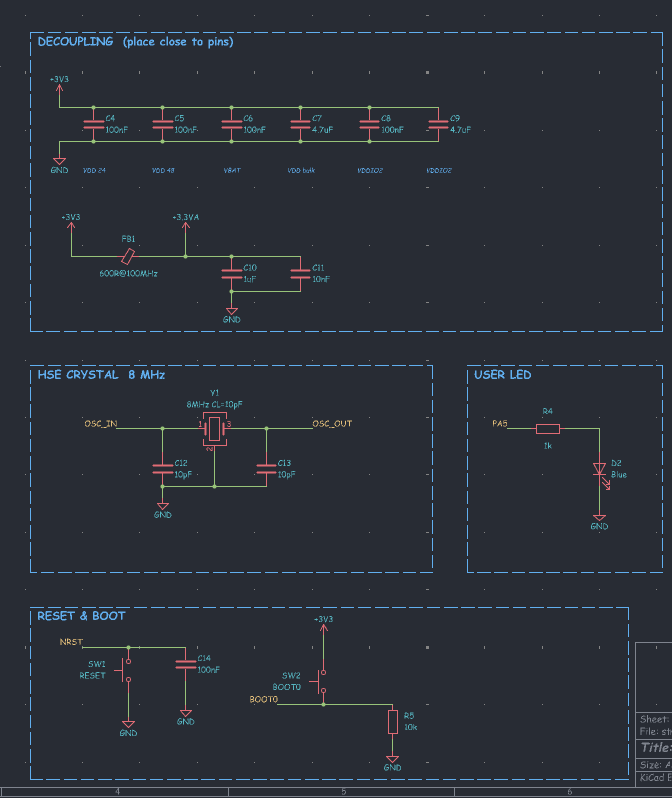 |

i put everything in its own box with a title, way easier to read

--- 

### journal #5 swd and gpio headers  
time spent : 1.5 hours   

  
for programming and debugging i added two options. a 10 pin cortex debug header (1.27mm) that works with proper debug probes, and a normal 5 pin 2.54mm one with 3.3v, swdio, swclk, nrst and gnd so a cheap st-link clone can plug in with jumper wires  
  

  
| swd debug |
| --- |
| 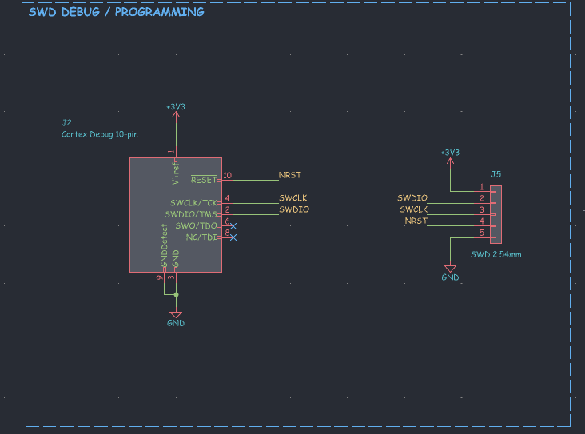 |

and then the main headers, two 20 pin rows. one has 3.3v, 5v and all of PA0 to PA15 and the other has all the PB pins plus PC13 to PC15, both with gnd at the end. basically every usable pin on the chip ends up on a header

  
| gpio headers |
| --- |
| 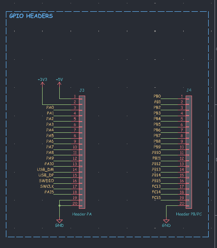 |

--- 

### journal #6 footprints and placing everything  
time spent : 2.5 hours   

  
0603 for most of the passives, 0805 for the bigger caps, lqfp-48 for the stm32, sot-223 for the regulator, the gct usb c connector and tl3342 buttons. made the board 72 x 30.48 mm, long and thin like a blue pill with a header on each long edge  
  
the trick here was rotating the stm32 by 45 degrees. it looks weird at first but it makes the traces from all 4 sides fan out way easier towards the headers. usb c on the left edge, regulator and fuse right next to it, crystal and decoupling caps hugging the chip, buttons on the right side so you can press them easily
  

  
| everything placed |
| --- |
| 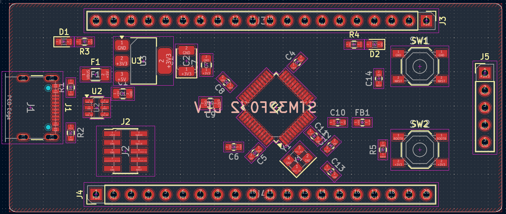 |

also put "STM32F072 DEV" and V1 on the silkscreen right across the chip lol

--- 

### journal #7 routing usb c  
time spent : 1.5 hours   

  
started routing with the usb side because thats the most important part. D+ and D- run together through the esd chip and straight to the stm32, kept them short and next to each other. vbus goes through the fuse to the regulator with a thicker trace
  

  
| usb c area | closer look |
| --- | --- |
| 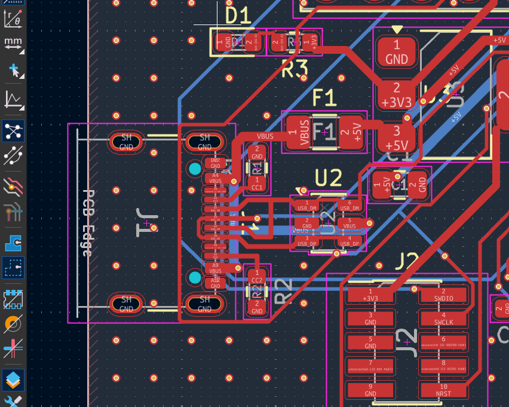 | 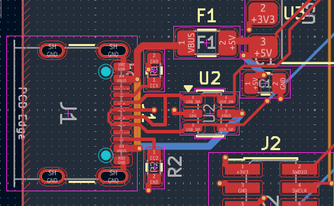 |

--- 

### journal #8 routing the stm32  
time spent : 4 hours   

  
this took the longest by far. 48 pins at 0.5mm pitch, and almost every single one goes to a header. i routed the decoupling caps first so each one is right next to its pin, then the crystal, then fanned out all the gpio pins  
  

  
| fanout from the chip |
| --- |
| 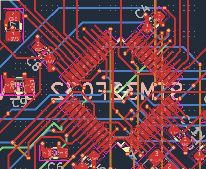 |

some of the pins come out in a completely different order from the headers, so i had to jump to the back layer with vias a lot. this is where having a 4 layer board really helped, i could run traces on the top and bottom without worrying about ground

  
| routing around the chip | decoupling caps |
| --- | --- |
| 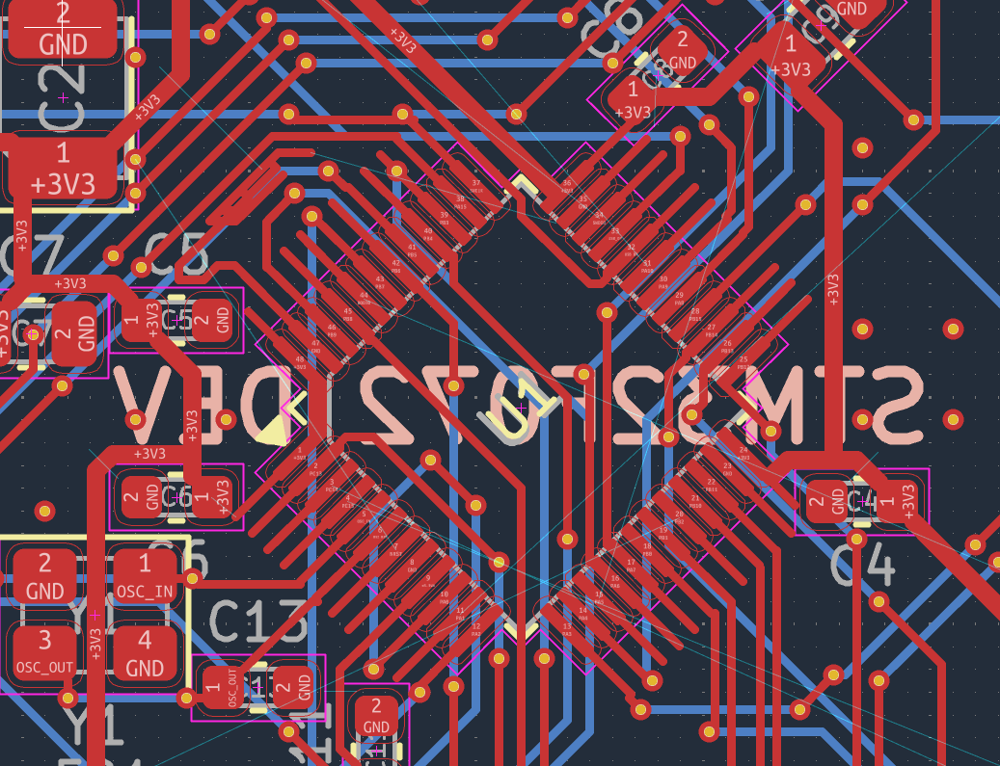 | 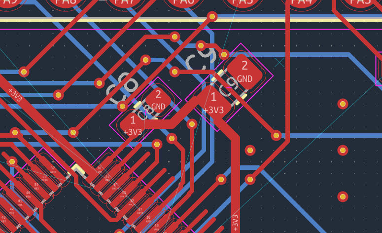 |

ripped up and redid some parts like 3 times until it looked clean, kinda satisfying when it finally all fits

--- 

### journal #9 headers, buttons and swd  
time spent : 2 hours   

  
then the rest. the reset button with its cap right next to it, the boot0 button and the user led, and the two swd headers. after that connecting every gpio to its header pin, which is a lot of the same thing over and over  
  

  
| reset button | swd header |
| --- | --- |
| 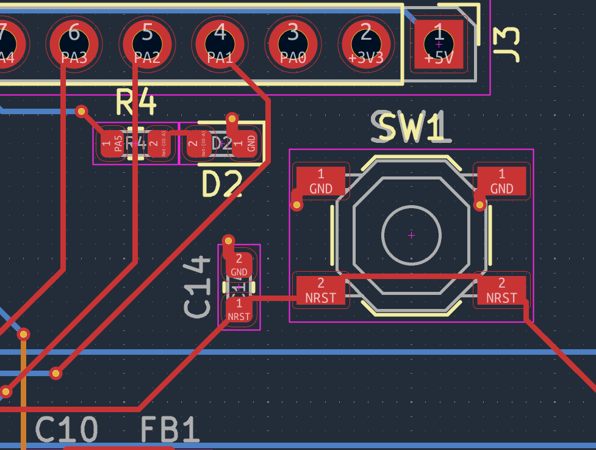 | 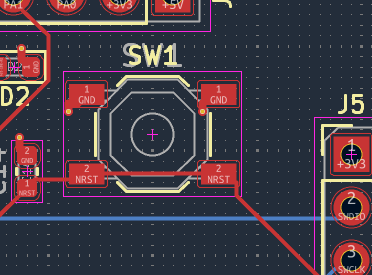 |

--- 

### journal #10 4 layers and ground pours  
time spent : 2 hours   

  
this is a 4 layer board so i used a pour on every layer. inner 1 is a solid ground plane and inner 2 is a 3.3v plane, so power gets to every chip pin with just a via instead of long traces. the top and bottom get ground fills too. having a full ground plane right under the top layer is really good for the usb lines and the crystal  
  

  
| top pour | close up |
| --- | --- |
| 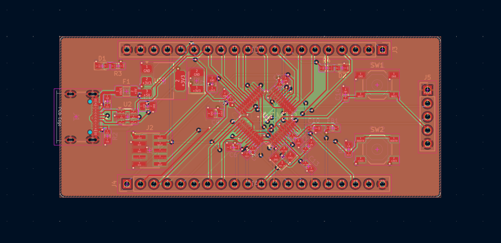 | 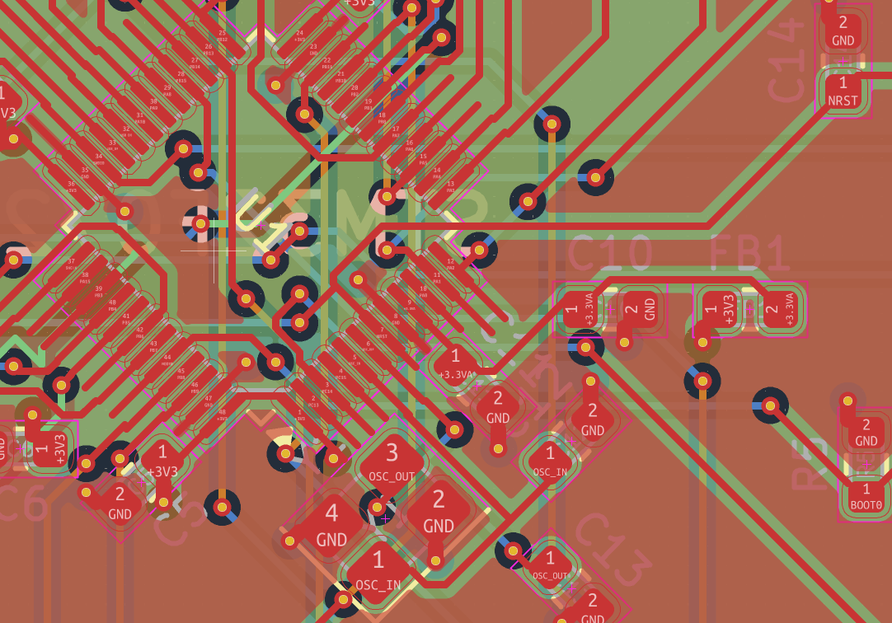 |

then i added a bunch of stitching vias all over the board to tie the ground on the top, bottom and inner 1 together, ended up with 99 vias in total

  
| all layers on |
| --- |
| 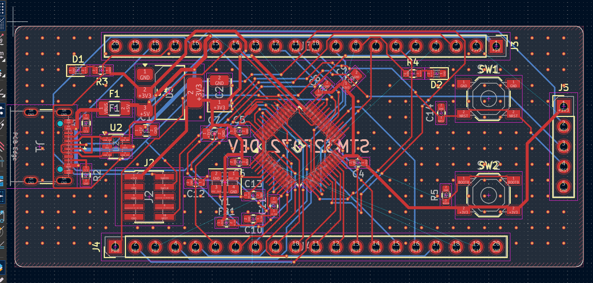 |

--- 

### journal #11 drc and cleanup  
time spent : 1.8 hours   

  
ran drc and went through every error and warning. moved silkscreen text that was sitting on pads, fixed some clearance stuff near the chip and made sure nothing was left unrouted. also checked that the pour actually connects to every ground pad and there are no random islands of copper  
  

  
| fully routed |
| --- |
| 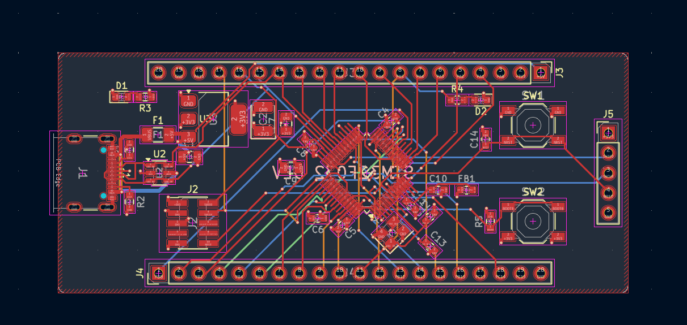 |
| 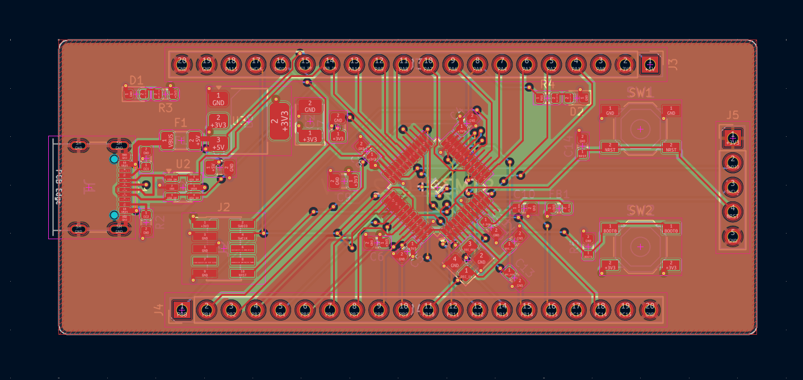 |

--- 

### journal #12 production files  
time spent : 1 hour   

  
generated the gerbers, drill files, bom and the position file so jlcpcb can make and assemble it. went through the bom and made sure every part has the right footprint and value.
  

  
| owl v1 |
| --- |
| 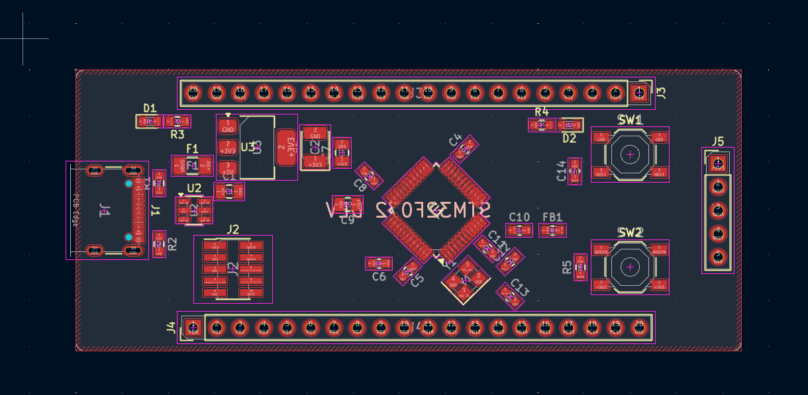 |

the board itself is done! but it was looking a bit plain, so time for art

--- 

### journal #13 art on the back  
time spent : 2 hours   

  
the back of the board was completely empty so obviously it needed art. i wrote "Owl", "made by" and "Shadow" in a cursive font and exported each one as an image
  

  
| the text i made |
| --- |
| 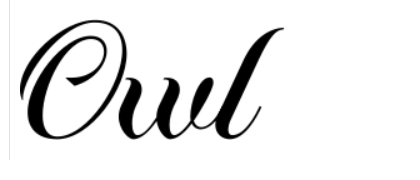 |
| 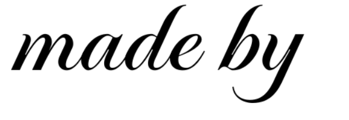 |
|  |

then i found a really pretty line drawing with little flowers around it and put it in the middle of the back. imported everything with kicads image converter as back silkscreen and lined it all up between the two header rows. the hard part was making the drawing big enough to look good but not cover any of the header pads or vias, had to scale it like 10 times  
  

  
| back art | with the gold finish |
| --- | --- |
| 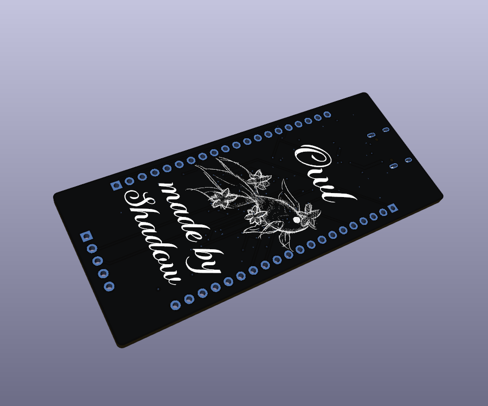 | 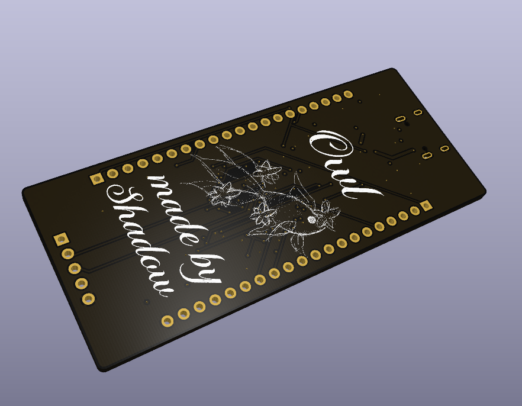 |

honestly the back might be my favourite part of the whole board now :D

--- 

### journal #14 renders  
time spent : 1 hour   

  
took some renders in the kicad 3d viewer with the black solder mask and gold pads. turned off the pin headers so you can see the board properly, and tried a few angles until it looked good
  

  
| front | angled |
| --- | --- |
| 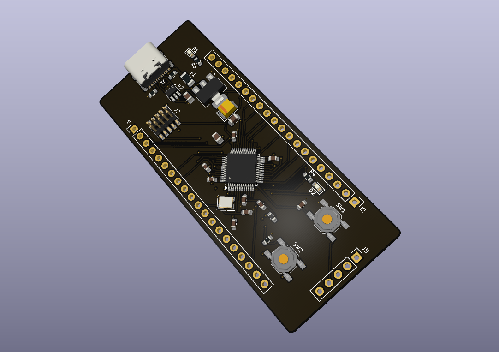 | 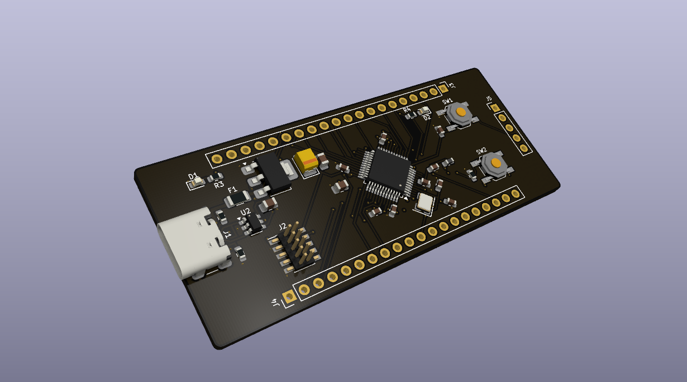 |

--- 

### journal #15 making the zine  
time spent : 1.5 hours   

  
made a zine for owl in canva, same style as the rin one so they kinda match. beige and cream background with orange outline shapes, big OWL text going down the side, the front and back renders in the middle and a short line about what the board is at the bottom. took a while to get the two boards to overlap nicely
  

  
| the zine | in canva |
| --- | --- |
| 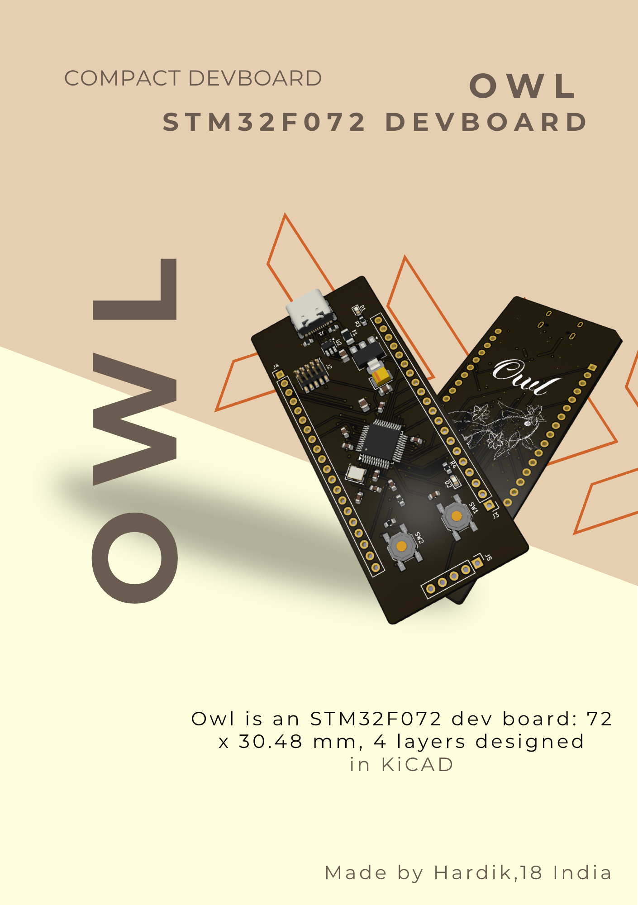 | 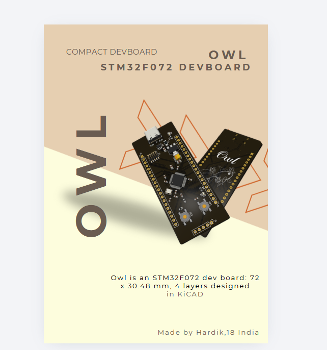 |

--- 

### journal #16 bom, readme and github  
time spent : 0.5 hours   

  
last thing! got the quote from jlcpcb for the 4 layer board with assembly, it came to 43.60$ plus 8.19$ shipping, so 51.79$ total which is not bad at all for a 4 layer board with everything soldered on. made a bom.csv with that, wrote the readme, sorted everything into folders and uploaded it all to github
  

  
| owl |
| --- |
|  |

thats owl done! my own stm32 dev board, if you read till here thank you :D
