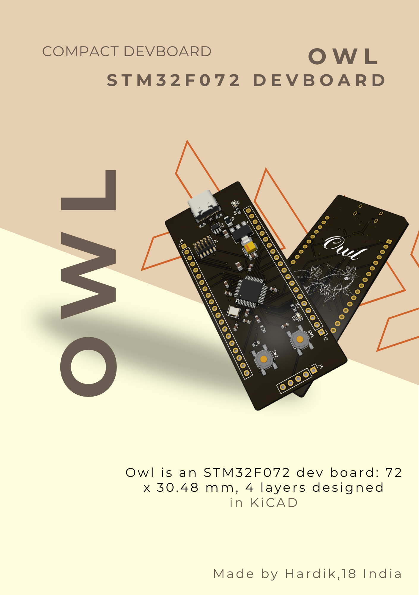
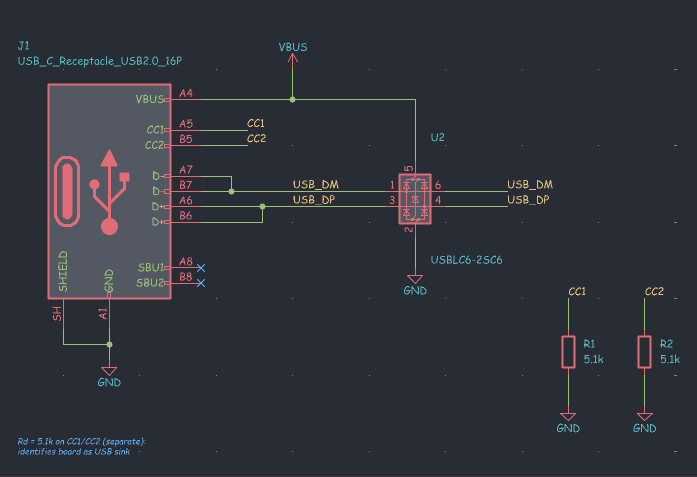
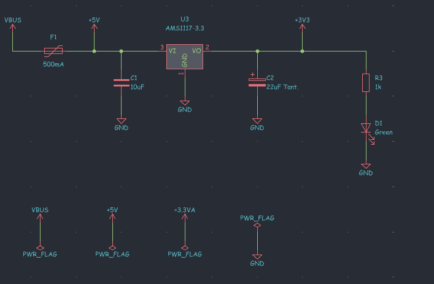
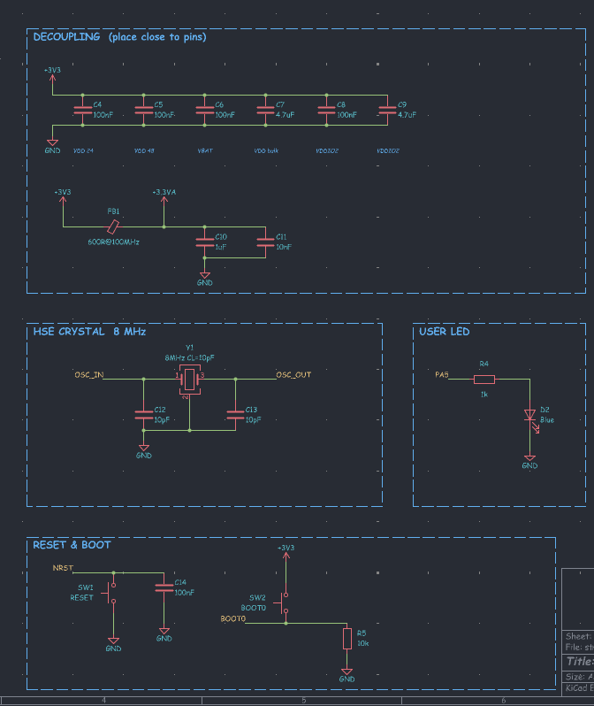
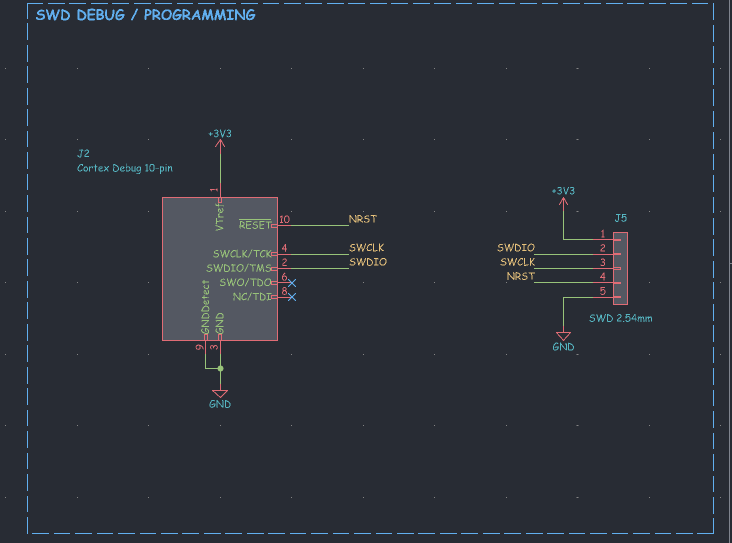
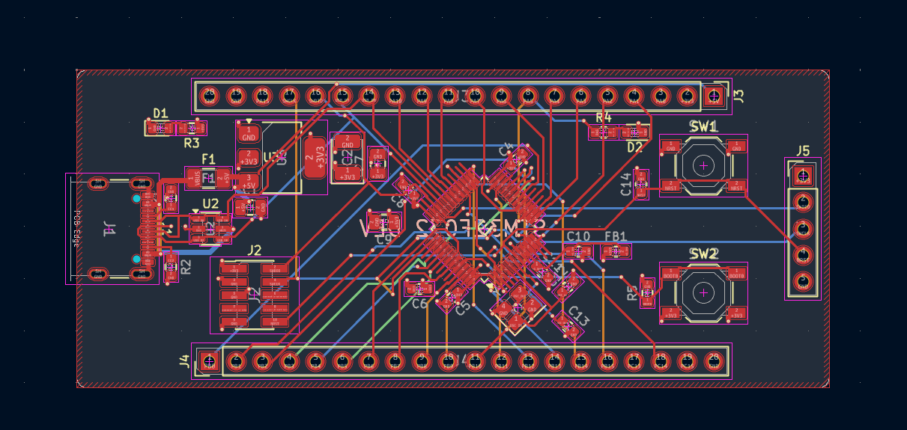
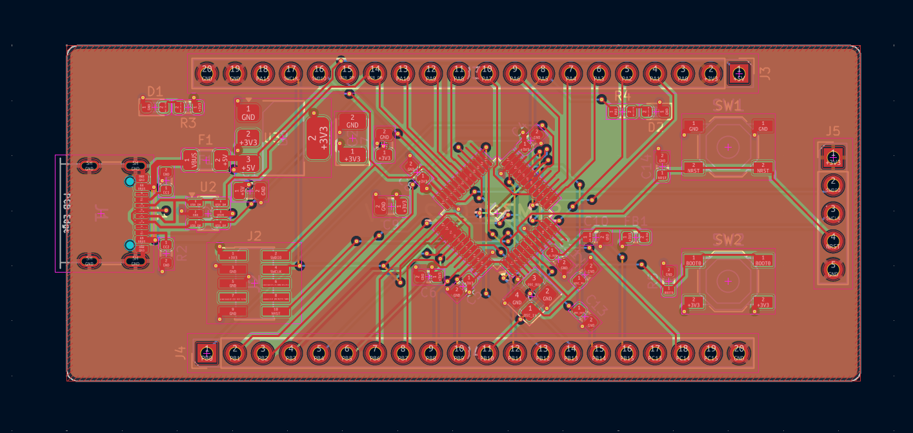
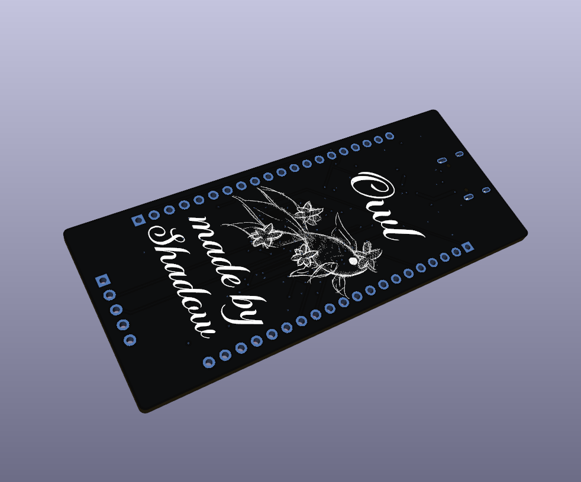

<h1 align="center">
 
Owl
 
</h1>

<h3 align="center">

A compact STM32F072 dev board with USB-C :D

</h3>

  
  

Owl is my own STM32 dev board, kinda like a blue pill but with USB-C and made by me. It uses the STM32F072CBT6 which has native USB, so you can plug it in and flash it over USB using the built in bootloader, no programmer needed. Every usable pin goes out to the two long headers on the sides.

The PCB is 4 layers, 72 x 30.48 mm, black with gold pads, and it has some art on the back cause a plain back is boring.

## Features

* STM32F072CBT6, 48 MHz Cortex-M0, 128kb flash, native USB
* USB-C with 5.1k CC resistors, USBLC6 ESD protection and a 500mA fuse
* AMS1117 3.3V regulator
* 8 MHz crystal
* Reset and BOOT0 buttons, hold BOOT0 and press reset to get into the USB bootloader
* Blue user LED on PA5 and a green power LED
* 10 pin Cortex debug header and a 5 pin 2.54mm SWD header for cheap ST-Link clones
* Two 20 pin headers with every PA, PB and PC13-15 pin
* Ground plane on inner 1 and a 3.3V plane on inner 2

PA11 and PA12 are the USB data lines and PA13 / PA14 are SWDIO and SWCLK, so try not to use those for other stuff.

## Schematic

|USB-C|Power|
|-|-|
|||

|Decoupling, crystal, reset and boot|SWD|
|-|-|
|||

## PCB

|Routed|Ground pour|
|-|-|
|||

The STM32 is rotated 45 degrees so the traces fan out to the headers easier. The decoupling caps and crystal sit right next to the chip and there are 99 vias stitching the grounds together.

## Art

The back has "Owl" and "made by Shadow" in cursive with a little line drawing with flowers in the middle.

## Why was it made?

I wanted a dev board that's actually mine, with USB-C and all the pins broken out, instead of buying another blue pill. And designing a 4 layer board around an STM32 seemed like a fun way to learn :D

## BOM

|Item|Qty|Price ($)|Vendor|
|-|-|-|-|
|PCBA (4 layer PCB + assembly)|1|43.60|JLCPCB|
|Shipping|1|8.19|JLCPCB|
|Total||51.79||

Here is the full LCSC BOM of individual parts generated from KiCAD 

|Designator         |Footprint                                              |Quantity|Value                      |LCSC Part #|Part Name                                    |Unit Price (USD)|Ext Price (USD)|Price Tier|
|-------------------|-------------------------------------------------------|--------|---------------------------|-----------|---------------------------------------------|----------------|---------------|----------|
|C1                 |0805                                                   |1       |10uF                       |C15850     |Samsung CL21A106KAYNNNE                      |0.0856          |0.0856         |20+       |
|C10                |0603                                                   |1       |1uF                        |C15849     |Samsung CL10A105KB8NNNC                      |0.0056          |0.0056         |50+       |
|C11                |0603                                                   |1       |10nF                       |C57112     |Fenghua 0603B103K500NT                       |0.0116          |0.0116         |50+       |
|C12, C13           |0603                                                   |2       |10pF                       |C1634      |Samsung CL10C100JB8NNNC                      |0.0059          |0.0118         |100+      |
|C14, C4, C5, C6, C8|0603                                                   |5       |100nF                      |C14663     |Yageo CC0603KRX7R9BB104                      |0.0025          |0.0125         |1+        |
|C2                 |CP_EIA-3528-21_Kemet-B                                 |1       |22uF Tant.                 |C8020      |Kyocera AVX TAJB226K016RNJ                   |0.1988          |0.1988         |1+        |
|C7, C9             |0805                                                   |2       |4.7uF                      |C1779      |Samsung CL21A475KAQNNNE                      |0.0147          |0.0294         |20+       |
|D1                 |0603                                                   |1       |Green                      |C72043     |Everlight 19-217/GHC-YR1S2/3T                |0.0309          |0.0309         |20+       |
|D2                 |0603                                                   |1       |Blue                       |C72041     |Everlight 19-217/BHC-ZL1M2RY/3T              |0.0172          |0.0172         |20+       |
|F1                 |1206                                                   |1       |500mA                      |C883122    |BHFUSE BSMD1206-050-6V (PTC resettable)      |0.0453          |0.0453         |10+       |
|FB1                |0603                                                   |1       |600R@100MHz                |C1002      |Sunlord GZ1608D601TF                         |0.0047          |0.0047         |20+       |
|J1                 |USB_C_Receptacle_GCT_USB4105-xx-A_16P_TopMnt_Horizontal|1       |USB_C_Receptacle_USB2.0_16P|C3020560   |GCT USB4105-GF-A                             |1.2075          |1.2075         |1+        |
|J2                 |PinHeader_2x05_P1.27mm_Vertical_SMD                    |1       |Cortex Debug 10-pin        |C3975188   |HCTL PZ127-2-05-S                            |0.1456          |0.1456         |5+        |
|J3                 |PinHeader_1x20_P2.54mm_Vertical                        |1       |Header PA                  |C50981     |BOOMELE 2.54-1*20P pin header                |0.0999          |0.0999         |5+        |
|J4                 |PinHeader_1x20_P2.54mm_Vertical                        |1       |Header PB/PC               |C50981     |BOOMELE 2.54-1*20P pin header                |0.0999          |0.0999         |5+        |
|J5                 |PinHeader_1x05_P2.54mm_Vertical                        |1       |SWD 2.54mm                 |C50981     |BOOMELE 2.54-1*20P pin header (cut to 5 pins)|0.0999          |0.0999         |5+        |
|R1, R2             |0603                                                   |2       |5.1k                       |C23186     |UNI-ROYAL 0603WAF5101T5E                     |0.0012          |0.0024         |100+      |
|R3, R4             |0603                                                   |2       |1k                         |C21190     |UNI-ROYAL 0603WAF1001T5E                     |0.0010          |0.0020         |100+      |
|R5                 |0603                                                   |1       |10k                        |C25804     |UNI-ROYAL 0603WAF1002T5E                     |0.0010          |0.0010         |100+      |
|SW1                |SW_SPST_TL3342                                         |1       |RESET                      |C2886898   |E-Switch TL3342F160QG                        |0.6625          |0.6625         |1+        |
|SW2                |SW_SPST_TL3342                                         |1       |BOOT0                      |C2886898   |E-Switch TL3342F160QG                        |0.6625          |0.6625         |1+        |
|U1                 |LQFP-48_7x7mm_P0.5mm                                   |1       |STM32F072CBTx              |C81720     |STMicroelectronics STM32F072CBT6             |1.3444          |1.3444         |1+        |
|U2                 |SOT-23-6                                               |1       |USBLC6-2SC6                |C7519      |STMicroelectronics USBLC6-2SC6               |0.1116          |0.1116         |5+        |
|U3                 |SOT-223-3_TabPin2                                      |1       |AMS1117-3.3                |C6186      |Advanced Monolithic Systems AMS1117-3.3      |0.2259          |0.2259         |5+        |
|Y1                 |Crystal_SMD_3225-4Pin_3.2x2.5mm                        |1       |8MHz CL=10pF               |C518154    |Suzhou Liming 3225-8.00-10-10-10/A           |0.2480          |0.2480         |5+        |

